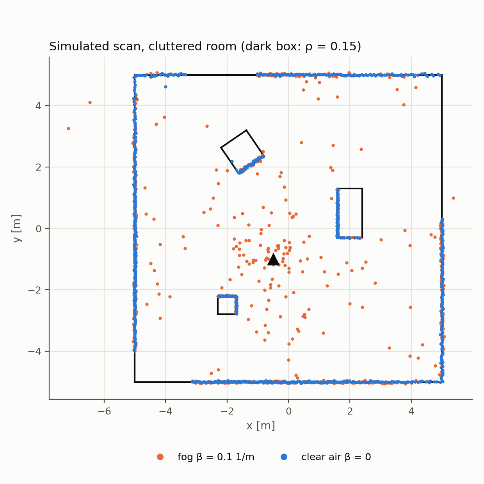
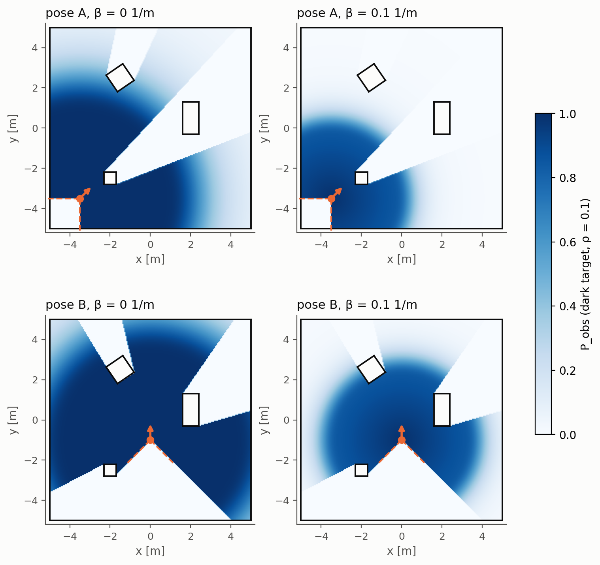
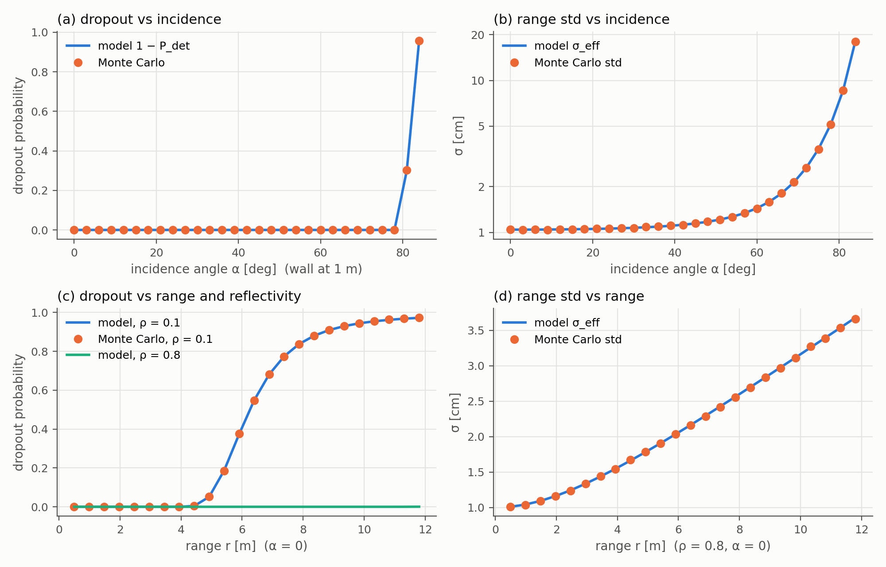
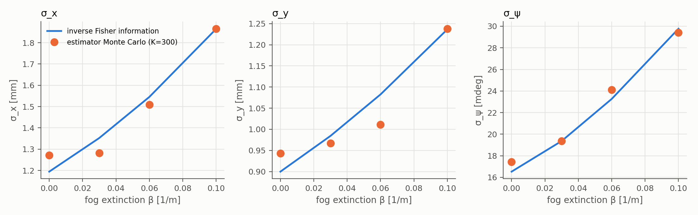

# Custom 2-D LiDAR Sensor Model

A from-scratch measurement model of a 2-D scanning LiDAR for a differential-drive robot, written in Python.
For every beam it predicts **where the beam hits, how strong the return is, whether it is detected, how noisy the
range is, and how fog corrupts it**. It then uses those predictions to compute **how precisely a scan can localize
the robot** (Fisher information and Cramér–Rao bound).

The model is built in three layers that feed each other, plus a field-of-view / line-of-sight map that
comes from the same ray geometry:

| Layer | Question it answers | Main output |
|---|---|---|
| **Physics-based** | Where does the beam hit, and how much light comes back? | range $r$, incidence angle $\alpha$, signal $S$ |
| **Probabilistic** | What reading will the sensor actually report? | $P_{\mathrm{det}}$, $\sigma_{\mathrm{eff}}$, beam mixture $p(z)$ |
| **Estimation-theoretic** | How well can the scan determine the robot pose? | Jacobian $H$, Fisher information $I$, CRB $I^{-1}$ |
| **FOV / LOS** | Which points in the room can the sensor see? | observation map $P_{\mathrm{obs}}(q)$ |

Developed for MAE 5810 Robot Perception (Cornell) as the midterm project.

<p align="center">
  
  
</p>

---

## The model

### 1. Physics-based: range and signal strength
The sensor has pose $x = [p_x,\ p_y,\ \psi]^\top$. The world is a set of straight walls, each with unit normal $n$
and offset $d$ (points on the wall satisfy $n\cdot q = d$); boxes are four walls each. Beam $i$ travels along the
unit vector $u_i$, and its range is the **first** wall it meets:

$$
r_i = \min_{\text{walls hit}} \frac{d - n\cdot p}{n\cdot u_i}, \qquad \alpha_i = \arccos|n\cdot u_i|
$$

Taking the first hit is what produces occlusion. Readings outside $[r_{\min}, r_{\max}]$ are reported as "no return".

The received signal follows the lidar equation for a Lambertian surface with Beer–Lambert fog loss, normalized to a
reference target ($\rho_{\mathrm{ref}} = 0.8$ seen head-on at $r_{\mathrm{ref}} = 5$ m in clear air):

$$
S = \frac{\rho}{\rho_{\mathrm{ref}}}\cos\alpha \left(\frac{r_{\mathrm{ref}}}{r}\right)^2 e^{-2\beta r}
$$

Darker surfaces ($\rho$), slanted surfaces ($\cos\alpha$), distance ($1/r^2$) and fog ($e^{-2\beta r}$, both ways)
all weaken the return.

### 2. Probabilistic: detection, noise, and fog
**Detection.** The receiver reports a return only if signal plus Gaussian electronic noise crosses a threshold:

$$
P_{\mathrm{det}} = \Phi\left(\frac{S - S_{\min}}{\sigma_n}\right)
$$

**Range noise.** Timing noise grows as the signal weakens, and beam-pointing jitter matters on slanted surfaces:

$$
\sigma_r^2 = \sigma_0^2 + \frac{\sigma_1^2}{S}, \qquad \sigma_{\mathrm{eff}}^2 = \sigma_r^2 + (r\tan\alpha\ \sigma_\theta)^2
$$

**Fog echoes and outliers.** Fog droplets reflect the pulse early, modeled as a Poisson process with rate
$\lambda = \kappa\beta$ per meter. Each beam therefore has four possible outcomes:

| Outcome | Probability |
|---|---|
| target detected | $w_{\mathrm{hit}} = (1-z_{\mathrm{rand}})\ e^{-\lambda r_c} P_{\mathrm{det}}$ |
| early fog echo | $w_{\mathrm{short}} = (1-z_{\mathrm{rand}})\ (e^{-\lambda r_{\min}} - e^{-\lambda r_c})$ |
| no return | $w_{\max} = (1-z_{\mathrm{rand}})\ [1 - e^{-\lambda r_{\min}} + e^{-\lambda r_c}(1-P_{\mathrm{det}})]$ |
| random outlier | $w_{\mathrm{rand}} = z_{\mathrm{rand}}$ |

This is a physically derived version of the beam model from *Probabilistic Robotics*: the mixture weights come from
the signal and the fog level instead of being hand-tuned.

### 3. Estimation-theoretic: how well can the robot be localized?
The Jacobian of each range with respect to the pose, and the Fisher information of a whole scan, are

$$
H_i = \left[-\frac{n^\top}{n\cdot u_i},\ \ -r_i\frac{n\cdot u_i^\perp}{n\cdot u_i}\right], \qquad
I(x) = \sum_i \frac{w_{\mathrm{hit},i}}{\sigma_{\mathrm{eff},i}^2} H_i^\top H_i, \qquad
\mathrm{Cov}(\hat{x}) \succeq I(x)^{-1}
$$

$I^{-1}$ is the Cramér–Rao bound: no unbiased estimator can localize the robot more precisely. A weighted, gated
Gauss–Newton estimator is included to check that the bound is actually reachable.

### 4. Field of view and line of sight
A small dark target at point $q$ is observed with probability

$$
P_{\mathrm{obs}}(q) = \mathbf{1}_{\mathrm{FOV}}(q)\cdot\mathbf{1}_{\mathrm{LOS}}(q)\cdot w_{\mathrm{hit}}(q)
$$

where the first factor depends only on the sensor pose (range limits and scanned sector), the second on the
obstacles (is anything in the way?), and the third on the target and the air (reflectivity and fog).

---

## Repository layout

```
src/robot_sensors/
├── config/
│   └── scenes.yaml            # wall, corner, and cluttered-room scenes
└── custom_lidar_model/
    ├── __init__.py
    ├── model.py               # physics + probabilistic model, FOV/LOS, scan sampler
    ├── estimation.py          # Jacobian, Fisher information, CRB, Gauss–Newton estimator
    ├── scene.py               # loads scenes.yaml into walls (boxes -> 4 walls)
    └── run_experiments.py     # experiments E1–E8, figures, and summary.json
```

### Key functions

| File | Function | What it does |
|---|---|---|
| `model.py` | `SensorParams` | all sensor parameters in one dataclass |
| | `raycast(p, psi, thetas, walls, prm)` | first-hit range, wall index, and incidence angle per beam |
| | `received_signal`, `p_detect`, `sigma_range`, `sigma_eff` | signal strength, detection probability, range noise |
| | `mixture_weights` | probabilities of the four outcomes |
| | `predict(x, walls, thetas, beta, prm)` | all of the above for every beam in one call |
| | `sample_scan(x, walls, thetas, beta, prm, rng)` | draws one random scan from the model |
| | `beam_density` | likelihood $p(z)$ of a reading |
| | `p_observe(points, x, walls, beta, prm, ...)` | FOV × LOS × detection map |
| `estimation.py` | `range_jacobian` | $H_i$ for every beam |
| | `information_matrix`, `crb` | Fisher information and its inverse |
| | `gn_localize` | weighted Gauss–Newton pose estimate with outlier gating |
| `scene.py` | `load_scene(path, name)` | builds the wall list for a named scene |

---

## Getting started

**Requirements:** Python 3.9+, `numpy`, `matplotlib`, `pyyaml`. `scipy` is optional (used for a faster normal CDF if
available).

```bash
pip install numpy matplotlib pyyaml scipy
```

**Run all experiments** (from `src/robot_sensors`, so the package can be imported as a module):

```bash
cd src/robot_sensors
python3 -m custom_lidar_model.run_experiments --out results           # full run
python3 -m custom_lidar_model.run_experiments --out results --quick   # fewer Monte Carlo draws, faster
```

This writes all figures (`fig_*.png`) and a `summary.json` with every number to `results/`. All random draws use
fixed seeds, so the results are reproducible.

**Use the model directly:**

```python
import numpy as np
from custom_lidar_model.model import SensorParams, Wall, predict, sample_scan

prm = SensorParams()
walls = [Wall([4, -5], [4, 5], rho=0.8)]           # one wall 4 m ahead
thetas = np.deg2rad(np.arange(-135, 135, 1.0))    # 270° scan, 1° steps
x = np.array([0.0, 0.0, 0.0])                      # pose (x, y, heading)

pred = predict(x, walls, thetas, beta=0.1, prm=prm)   # model predictions per beam
i = 135                                             # the head-on beam (θ = 0°)
print(pred.r[i], pred.p_det[i], pred.sigma_eff[i], pred.w_hit[i])

z = sample_scan(x, walls, thetas, beta=0.1, prm=prm, rng=np.random.default_rng(0))
print(z[i])                                         # one simulated scan (inf = no return)
```

**Scenes** are defined in `config/scenes.yaml`. Walls are listed counter-clockwise (free space on the left of each
segment); boxes are given by center, size, yaw, and reflectivity.

---

## Default parameters

| Symbol | Value | Meaning | Symbol | Value | Meaning |
|---|---|---|---|---|---|
| $r_{\min}, r_{\max}$ | 0.12, 12 m | range limits | $\sigma_0$ | 1 cm | range-noise floor |
| $\rho_{\mathrm{ref}}, r_{\mathrm{ref}}$ | 0.8, 5 m | reference target | $\sigma_1$ | 1.5 cm | photon-noise term at $S=1$ |
| $S_{\min}$ | 0.08 | detection threshold | $\sigma_\theta$ | 0.1° | beam-pointing jitter |
| $\sigma_n$ | 0.03 | detector noise | $z_{\mathrm{rand}}$ | 0.002 | outlier probability |
| $\kappa$ | 0.5 | fog echo rate per unit $\beta$ | $\beta$ | 0–0.25 m⁻¹ | fog extinction (swept) |

The range limits resemble a low-cost 2-D scanner (RPLIDAR A1); the other values are illustrative, not calibrated.

---

## Experiments and results

| ID | Experiment | Result |
|---|---|---|
| E1 | Ray-cast range vs. hand calculation | exact at all test angles |
| E2 | Dropout and range spread vs. angle and range (40,000 beams) | match the model within Monte Carlo error |
| E3 | Fog outcome probabilities vs. $\beta$ | match the mixture weights; fog turns target returns into early echoes |
| E4 | Simulated scans and FOV/LOS maps, two poses | fog at $\beta = 0.1$ cuts the dark-target detection range from 6.25 m to 3.99 m and roughly halves the visible area |
| E5 | Observability: one wall vs. a corner | one wall leaves sliding along it unobservable (rank 2); a corner fixes the full pose (rank 3) |
| E6 | Gauss–Newton estimator vs. CRB under fog | estimator spread within ±7 % of the bound; the bound grows steadily with fog |
| E7 | Information per beam vs. incidence angle | slanted beams beat head-on beams for near walls (1–2 m), not for far ones (4 m) |
| E8 | Position CRB map over the room | most precise near corners; fog hurts most where walls are far |

<p align="center">
  
  
</p>

### Analytical results (proven from the model, confirmed in simulation)
1. **Monotone dependencies:** signal and detection fall, and noise rises, with range, incidence angle, and fog;
   brighter targets do the opposite.
2. **Line of sight:** a point is visible exactly when the beam toward it reaches at least that far.
3. **Observability:** one flat wall gives a rank-2 Fisher information; two non-parallel walls give rank 3.
4. **Fog always costs precision:** the Cramér–Rao bound grows monotonically with $\beta$.
5. **Slanted vs. grazing beams:** grazing beams carry no information, but a slanted beam can beat a head-on one when
   $\sigma_0^2 > \tfrac{1}{2}\sigma_1^2/S_0 + D^2\sigma_\theta^2$.

---

## Limitations and future work
- Assumes flat Lambertian walls, uniform fog, and independent beams; parameters are illustrative, not calibrated.
- **Next step:** implement the model as a custom sensor in **Gazebo** under **ROS 2** and compare it with Gazebo's
  built-in LiDAR and with real scans to calibrate the parameters.
- Extensions: 3-D scanners, multiple echoes per pulse, and non-Lambertian (specular) surfaces.

## References
- S. Thrun, W. Burgard, and D. Fox, *Probabilistic Robotics*. MIT Press, 2005.
- S. M. Kay, *Fundamentals of Statistical Signal Processing, Vol. I: Estimation Theory*. Prentice Hall, 1993.
- R. M. Measures, *Laser Remote Sensing: Fundamentals and Applications*. Wiley, 1984.
- R. H. Rasshofer, M. Spies, and H. Spies, "Influences of weather phenomena on automotive laser radar systems,"
  *Adv. Radio Sci.*, vol. 9, pp. 49–60, 2011.
- M. Bijelic, T. Gruber, and W. Ritter, "A benchmark for lidar sensors in fog: Is detection breaking down?"
  *IEEE Intelligent Vehicles Symposium*, 2018.
